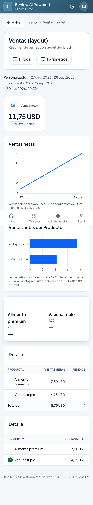

# Bizview

**English** · [Español](README.es.md)

[](docs/assets/readme-phone.png)

**Your business data on your phone. Build the reports with any AI — Bizview validates, runs and
shares them.**

Bizview is a self-hosted, mobile-first BI product. Every integration and every report is a
**declarative spec** (YAML plus read-only SQL). You write those specs **outside** Bizview — by hand,
in the project editor, or with whatever AI you prefer — against a published contract, and the
product validates them, imports them, runs them every day and shares the result. The product never
authors, and no model ever produces code the server executes.

[Install](#install-docker-compose) · [Hosted product](https://bizview.com) · [Connect my ERP](docs/AUTHORING.md)

## Install (Docker Compose)

Requirements: a Linux server with Docker and Docker Compose, and a **PostgreSQL** database you can
write to (Bizview never ships a database container; it is always external). For a public server,
also a domain pointing at it.

```bash
mkdir -p /opt/bizview && cd /opt/bizview
curl -fsSLO https://raw.githubusercontent.com/dvconsultores/bizview/main/bizview.yml
curl -fsSL  https://raw.githubusercontent.com/dvconsultores/bizview/main/.env.example -o .env
```

No clone needed: [`bizview.yml`](bizview.yml) is the whole stack (Caddy, backend, worker and
Watchtower) running the published images `dvconsultores/bizview-backend` and
`dvconsultores/bizview-web`. Four values in `.env` are enough to start:

```dotenv
DATABASE_URL_BI=******host:5432/bizview
SUPER_USER_EMAIL=you@example.com
SUPER_USER_PASSWORD=choose-a-long-password     # first start only
BIZVIEW_SECRET_KEY=<openssl rand -hex 32>      # encrypts stored credentials; back it up
```

Then:

```bash
mkdir -p projects image-cache && sudo chown -R 10001:10001 projects image-cache  # containers run as uid 10001
docker compose -f bizview.yml pull
docker compose -f bizview.yml up -d
```

(`projects/` and `image-cache/` are the host folders the app writes; without the `chown` it can read
them but not write.) To build the images from source instead, clone the repository and run
`docker compose -f bizview.yml up -d --build`.

- **Local or private network**: open `http://<server>:8081`. Keep `SECURITY_PROFILE=private`.
- **Public server**: set `SITE_ADDRESS=bi.example.com`, `CADDY_ALLOWED_HOSTS=bi.example.com`,
  `SECURITY_PROFILE=internet`, `COOKIE_SECURE=true`, `HTTPS_PORT=443`. Caddy obtains the
  certificate automatically. Open `https://bi.example.com`.

**Upgrade**: with the default `BIZVIEW_VERSION=latest`, Watchtower pulls new images automatically
(every 5 minutes, only the Bizview containers). To pin a version, set `BIZVIEW_VERSION=0.2.0` and
upgrade by changing it and running `docker compose -f bizview.yml pull && docker compose -f
bizview.yml up -d`. Ports, TLS behind another proxy, Cloudflare, backups and branding:
[docs/INSTALL.md](docs/INSTALL.md).

## How it works

1. **Add a source** — **Fuentes de datos → Nueva**, with the credentials and **Probar**.
2. **Describe it** — `bizview describe <source>` prints the tables, columns and types (structure and
   counts only, never rows).
3. **Download the authoring pack** — `bizview init workspace --name mycompany` writes the presets,
   the rules, the schemas and an example project.
4. **Write the request** — `REQUEST.md`: what the dashboard answers, for whom, with which filters.
5. **Build it with any AI (or by hand)** — the pack's `PROMPT.md` tells an agent the rules; the
   output is `specs/NNN-name/spec.md`, `integrations/<id>/integration.yaml|queries/*.sql` and
   `reports/<id>/report.yaml`.
6. **Validate** — `bizview validate .` runs the same validator the server runs and writes
   `problems.json` with a file, a JSON path, a message and, when it can, a fix.
7. **Import** — **Proyectos → Importar** takes the zip, maps the folders, reports collisions,
   validates again and shows the tree before anything is applied.
8. **Apply and share** — **Aplicar** creates a version; **Compartir** mints a read-only link,
   **Enviar por correo** schedules the PDF.

The contract, every file and a complete worked example: [docs/AUTHORING.md](docs/AUTHORING.md). The
import path: [docs/IMPORT.md](docs/IMPORT.md).

## What it does

| Capability | Spec |
|---|---|
| Spec-driven integrations (PostgreSQL, REST, SOAP, Supabase) run by a worker on a schedule | [005](specs/005-vibe-reporting/spec.md), [016](specs/016-supabase-source/spec.md) |
| Reports with metrics, dimensions, views, filters and periods; direct-source reports over an existing table | [005](specs/005-vibe-reporting/spec.md), [019](specs/019-direct-source-reports/spec.md) |
| Declarative layouts for dashboards and PDFs, rendered by the app on screen and by ReportLab on the server | [026](specs/026-declarative-layouts/spec.md) |
| BI projects: a folder per project with numbered specs, history and an in-browser editor; export as zip | [020](specs/020-bi-projects/spec.md) |
| Import and export as the front door: upload → map → collisions → validate → preview → apply | [020](specs/020-bi-projects/spec.md), [046](specs/046-release-docs-governance/spec.md) |
| The authoring pack: presets, rules, schemas, `PROMPT.md`, `REQUEST.md` and a golden example | [043](specs/043-bizview-refactor-external-authoring/spec.md) |
| Structure packs: a source's structure and counts as a document an external AI can read | [043](specs/043-bizview-refactor-external-authoring/spec.md) |
| Visual components: gauge, index, share and asset blocks, project images and a URL-image cache | [044](specs/044-visual-components-and-assets/spec.md) |
| Sharing: expiring read-only links, email delivery, scheduled sends | [018](specs/018-dashboard-sharing/spec.md) |
| Spanish and English, dark mode, PDF and CSV export | [022](specs/022-i18n-en-es/spec.md), [006](specs/006-dark-mode/spec.md) |
| Administration: users, roles, access, audit log, `internet` security profile, sign in with Google or Telegram | [002](specs/002-auth-admin-home/spec.md), [004](specs/004-data-sources-security/spec.md), [027](specs/027-google-sign-in/spec.md), [007](specs/007-telegram-sign-in/spec.md) |
| In-app guide, update notice, project search | [023](specs/023-chat-app-guide/spec.md), [025](specs/025-app-updates-and-search/spec.md) |

Mobile first: every screen works from 320 px, WCAG 2.2 AA. How to write reports:
[docs/AUTHORING.md](docs/AUTHORING.md).

## Configuration

[`.env.example`](.env.example) is the full list. The groups you will touch:

| Group | Settings |
|---|---|
| Database | `DATABASE_URL_BI` |
| Site and TLS | `SITE_ADDRESS`, `CADDY_ALLOWED_HOSTS`, `HTTP_PORT` (8081), `HTTPS_PORT` (8443; `443` on a public server), `CADDY_TLS`, `TRUSTED_PROXIES` |
| Security | `SECURITY_PROFILE` (`private` / `internet`), `COOKIE_SECURE`, `BIZVIEW_SECRET_KEY`, `SUPER_USER_EMAIL`, `SUPER_USER_PASSWORD` |
| Branding | `PRODUCT_NAME`, `ORGANIZATION_NAME`, `LOGO_URL`, `DEFAULT_LOCALE`, `TIMEZONE` |
| Projects | `PROJECTS_DIR`, `PROJECT_MAX_MB`, `IMAGE_CACHE_DIR`, `IMAGE_CACHE_DAYS` |
| AI (optional, off by default, **help only**) | `AI_PROVIDER` (`none` / `anthropic` / `openai_compatible`), `AI_API_KEY`, `AI_MODEL`, `AI_BASE_URL` (any OpenAI-compatible endpoint, including local models) |
| Mail and sharing | `SMTP_*`, `EMAIL_ALLOWED_DOMAINS`, `SHARE_LINKS_ENABLED` |
| Images | `BIZVIEW_IMAGE_PREFIX`, `BIZVIEW_VERSION` |

## How it is built

```text
browser ──HTTPS──▶ Caddy (SPA + /api + certificates) ──▶ FastAPI backend ──▶ PostgreSQL (external)
                                                              ├──▶ worker (ETL, mail, schedules, image cache)
                                                              └──▶ AI provider (optional, help page only)
projects/ (specs, YAML, SQL, assets) ────────────────────▶ backend + worker ──▶ data sources
                                                  authoring happens outside ──▶ import ──┘
```

Python 3.12 / FastAPI / SQLAlchemy / Alembic / ReportLab; React 19 / Vite / Tailwind; Caddy. The
`cli/` folder holds the `bizview` command, the JSON Schemas and the SQL rules that the CLI, the
backend and the authoring pack all read — one source for the contract. Specs live in
[`specs/`](specs/) with [Spec Kit](https://github.com/github/spec-kit); principles in
[`.specify/memory/constitution.md`](.specify/memory/constitution.md).

Development setup, tests and conventions: [CONTRIBUTING.md](CONTRIBUTING.md).

## Security

- `SECURITY_PROFILE=internet`: HTTPS everywhere, two-step sign-in for administrators, sign-in
  throttling, step-up confirmation for sensitive changes.
- Data-source credentials are encrypted at rest (AES-256-GCM) with `BIZVIEW_SECRET_KEY` and are
  write-only: never returned, shown or logged. Back the key up separately from the database.
- The origin databases are read-only for Bizview; connections refuse loopback, link-local and
  cloud-metadata addresses, and so do the fetches of an image a report asks for by URL.
- Import validates before anything runs: file types, sizes, content sniffing and SVG sanitisation.
- No AI authors inside the product. The optional provider serves the read-only help page; the
  structure packs you hand to an external AI contain structure, counts and shapes — never
  credentials, hosts or row values.

Report vulnerabilities privately through GitHub's *Security* tab: [SECURITY.md](SECURITY.md).

## Contributing

Issues and pull requests are welcome: read [CONTRIBUTING.md](CONTRIBUTING.md) for the development
stack, the specification workflow and the checks a pull request has to pass, and
[CODE_OF_CONDUCT.md](CODE_OF_CONDUCT.md) for how we treat each other.

## License

[GNU AGPL-3.0-or-later](LICENSE). If you run a modified version for others over a network you must
offer them its source; the app links to the source on every page (`SOURCE_URL`). The license does
not grant rights to the "Bizview" name or logo.
