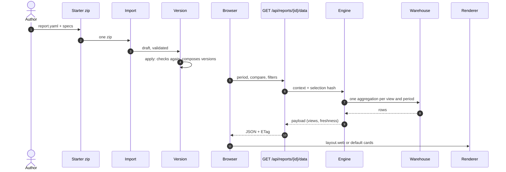

🇬🇧 English · 🇪🇸 [Español](es/RENDERING.md)

# How a report becomes a dashboard

[AUTHORING.md](./AUTHORING.md) tells you how to write a folder; [REPORTS.md](./REPORTS.md) lists
every field. This page is the third part: **what Bizview does with the `report.yaml` you wrote**,
from the moment you apply the project to the moment a reader hovers a bar. Every claim below names
the file that does it, so you can check it against the code.

The short version: your YAML never becomes code. It becomes a **version** (a checked-in tree), the
engine turns each `views` entry into **one SQL query per period**, and the browser draws the payload
with the **layout** you declared — or with a card per view when you declared none.

## The path in one picture



Source: [docs/assets/rendering.mmd](./assets/rendering.mmd), rendered as
[rendering.svg](./assets/rendering.svg).

## 1. Apply — the YAML joins a version

Import stores the zip as a **draft** project; apply is what makes it live. Applying validates the
tree again — the same validator the CLI runs, `cli/bizview_cli/validate.py` — and only then
composes the project with the others into a new **workspace version**: `apply` and
`_apply_composed` in [workspace/service.py](../backend/app/workspace/service.py). A version is
immutable once active, which is why everything downstream may cache against its id.

Two things happen at that moment and nowhere else:

- every report becomes a **dashboard row** — id, title, description, icon, order, `available` —
  in `sync_dashboards` ([workspace/service.py](../backend/app/workspace/service.py)); a report that
  left the version is *hidden*, never deleted;
- `access.roles` starts deciding who may open it. It is read per request, not stored: `_context` in
  [api/reports.py](../backend/app/api/reports.py) refuses a report whose roles exclude the caller,
  and `access.grants: true` asks for the per-user grant on top.

Rolling back (`rollback`, same file) marks the current version archived and activates the previous
one: same dashboards, same grants, older definitions.

## 2. Context — aliases become tables and columns

The engine never reads your `uses` names at query time. `_build_context`
([engine/report.py](../backend/app/engine/report.py)) resolves each alias to
`ds_<integration>.<dataset>` — `schema_name` in [engine/datasets.py](../backend/app/engine/datasets.py)
builds the schema from the integration id — and takes the **column contracts** from the integration
definition, so `lines.net_amount` is known to exist, and known to be numeric, before any SQL is
built.

That context is memoised per version (`cached_context`, same file): a version never changes, so the
parsed definition and the contracts are built once per process. Nothing has run yet.

## 3. Request — period, comparison, filters

The screen calls `GET /api/reports/{id}/data` with the parameters that are in the URL:

```text
period=mtd&compare=previous_period&filter.product=A-1&filter.product=B-2
```

`selection` ([engine/report.py](../backend/app/engine/report.py)) accepts only what the report
allows — `periods.allowed`, `compare.allowed` — and `periods.resolve`
([engine/periods.py](../backend/app/engine/periods.py)) turns the preset into two **inclusive local
dates** plus the comparison range. "Local" is the installation time zone: `_today` in
[api/reports.py](../backend/app/api/reports.py) asks the settings, not the browser, so the screen and
the PDF always agree on what "today" is.

Two values make the cache key, and both are computed in one round trip
(`data_version_and_cached`, [engine/report.py](../backend/app/engine/report.py)):

- the **selection hash** — SHA-256 of the resolved ranges and the filters, `selection_hash`;
- the **data version** — `v<version id>-r<last succeeded run id>`, `data_version`.

The payload is stored in `report_cache` and answered with `ETag: "<data_version>-<hash>"`
(`_data` and `report_data` in [api/reports.py](../backend/app/api/reports.py)); a request that
repeats the ETag gets `304` and draws no query at all. A new integration load changes the run id,
so the key changes and the next request recomputes — that is the whole freshness story of §6.

## 4. Views become SQL

Each entry of `views` is one aggregation per period, built by `aggregate`
([engine/report.py](../backend/app/engine/report.py)):

- **FROM** — the base alias of `date`, plus the joins in the order they connect
  (`from_clause`); a join that does not reach the base alias is an error card, not a silent cartesian
  product;
- **WHERE** — `date BETWEEN :start AND :end` and one `expr::text IN (...)` per filter (`_where`);
- **SELECT** — each metric's `sql` fragment, re-checked against the allow-list and regenerated with
  quoted identifiers by `expression`, so what runs is the parsed expression, not your string;
- **GROUP BY / ORDER BY / LIMIT** — by position and by metric alias, never by interpolated text.

This is a real statement the engine produced for a `ranking` view (products by net sales, top 5),
captured from the engine, not written by hand:

```sql
SELECT "products"."product_code" AS "g0",
       SUM(CASE WHEN "lines"."line_kind" = 'sale' THEN "lines"."net_amount"
                ELSE -"lines"."net_amount" END) AS "m_net_sales"
FROM "ds_ventas_prueba"."sale_lines" AS "lines"
LEFT JOIN "ds_ventas_prueba"."products" AS "products"
       ON "lines"."product_code" = "products"."product_code"
WHERE ("lines"."local_date")::date BETWEEN '2026-09-01'::date AND '2026-09-30'::date
GROUP BY 1
ORDER BY "m_net_sales" DESC NULLS LAST, 1
LIMIT 5
```

Formulas are not SQL: `aggregate` returns the SQL metrics and `evaluate` applies the formula over
them, so `avg_ticket: net_sales / orders` is one division of two aggregates, and a zero base gives
null instead of an error.

What each view type asks for:

| View | Queries per period | Result |
|---|---|---|
| `kpis` | one aggregate, no group | one row of metrics |
| `ranking` | one aggregate grouped by the dimension, ordered by the metric, limited; plus the total for `share`; plus one ranged query for the previous keys | the top N with `share`, `previous`, `change` |
| `trend` | one aggregate grouped by `date_trunc(grain, date)` | a point per bucket, holes included |
| `table` | one aggregate grouped by the declared dimensions, ordered by the first metric | rows and their columns |

The comparison is a second run over the previous range, paired by key: `ranking` asks for exactly
the keys it returned, `trend` pairs bucket by bucket, `kpis` compares the single row. `change`
([engine/periods.py](../backend/app/engine/periods.py)) turns the pair into a percentage and flags a
zero base as *new* rather than inventing 100 %.

A report with `materialize: daily` does not read the dataset at all when its rollup is fresh:
`routed` ([engine/report.py](../backend/app/engine/report.py)) swaps FROM for the rollup table —
`mv_<report id>` (dashes become underscores), one row per day and dimension, maintained by
[engine/rollup.py](../backend/app/engine/rollup.py) — and `_raw_on_missing` drops back to the raw
path (marking the rollup stale) if the table or a column disappeared.

Isolation, because the same code runs for every customer: statements run in a read-only transaction
with a 15 s statement limit, values travel as psycopg literals, the report's views are computed four
at a time (`PARALLEL_VIEWS`), and **a failing view is that card only** (`_run_view`,
`_failed_view`); a view with nothing in it says so (`_mark_empty`) instead of looking broken.

## 5. Render — layout, cards, formats

The browser asks for the definition (`GET /api/reports/{id}`) and the data, then
[ReportViews.tsx](../frontend/src/components/report/ReportViews.tsx) decides:

- **a layout was declared** (`layout.web`): [LayoutRenderer.tsx](../frontend/src/components/report/LayoutRenderer.tsx)
  draws the 12-column grid and each component binds to a view **by id** (`resolveView`), with
  `metric`, `x`/`series`, `category`/`value` choosing what that component reads from it. Span,
  minimum height and theme tokens are the layout contract (026); validation warnings travel in
  `layout_problems` (`engine/report.py`) and are shown as a quiet note, never as a failure;
- **no layout**: one default card per view, in payload order, each type with its own card.

Numbers are formatted **in the browser**: `format:` (`number`, `integer`, `currency`, `percent`) and
the installation `currency` go through
[numbers.ts](../frontend/src/lib/numbers.ts), so a value reads `84.401,05 USD` in Spanish and
`84,401.05 USD` in English. The PDF uses the same rules server-side (`fmt` in
[reports/pdf.py](../backend/app/reports/pdf.py)) over the *same* payload, and `layout.pdf` blocks
when the report declares them — that is why the paper and the screen cannot disagree.

The URL keeps the state: `period`, `compare`, `from`/`to`, `filter.<dimension>` and, on a maximised
card, `ampliar=<component id>` ([reportQuery.ts](../frontend/src/lib/reportQuery.ts)). TV mode
ignores `ampliar`, so a shared link cannot leave a wall screen stuck in a dialog.

## 6. Freshness — when the numbers change

| What you see | What happened |
|---|---|
| "Datos actualizados …" | the payload's `freshness.updated_at`: the last successful load of the integrations it reads |
| the page refreshed by itself | auto-refresh polled `GET /api/reports/{id}/version` and found another `data_version` ([autoRefresh.ts](../frontend/src/lib/autoRefresh.ts)) |
| figures from yesterday, labelled | `materialize: daily` read the stored snapshot of that day ([engine/snapshot.py](../backend/app/engine/snapshot.py)) |
| a stale warning | a direct report could not reach its source; the last figures are shown with their time ([freshness.ts](../frontend/src/lib/freshness.ts)) |

A dataset report is **as fresh as its last load**: the worker writes to `ds_<integration>.<dataset>`,
the run is recorded, and the next request sees a new run id and recomputes. Nothing else expires.

## What each key controls at run time

| Key | What it decides | Read by |
|---|---|---|
| `date` | the column the range filters on, and the base alias of the joins | `date_expression`, `from_clause` |
| `periods` | which presets are accepted and which one opens the report | `selection`, `ReportDefinition` |
| `compare` | whether a second range runs, and which one | `selection`, `periods.previous_range` |
| `filters` | which `filter.<dimension>` parameters are read, and the `IN` list | `selection`, `_where` |
| `metrics.sql` | the SQL fragment aggregated | `expression`, `aggregate` |
| `metrics.formula` | a value computed after the aggregates | `evaluate` |
| `views.limit` | how many rows a ranking or a table returns | `view_ranking`, `view_table` |
| `layout.web.span` | how many of the twelve columns the card takes | `LayoutRenderer` |
| `materialize` | whether the rollup is read instead of the dataset | `routed`, `rollup` |
| `access` | who may open the dashboard, and whether a grant is also needed | `_context` |

## Where to look when it does not draw

- **A card says "no data"** — the range is empty for that view; the message names the datasets that
  are empty when the whole dataset is (`_empty_refs`).
- **A card shows an error with a reference** — that view failed and the others did not; the
  reference ties the card to its lines in the server log (`render_reference`).
- **The dashboard looks different from the YAML** — validation downgraded part of the layout; the
  notes above the grid say which component and why (`layout_problems`).
- **The numbers are old** — look at the integration's last run: its id is part of `data_version`.

## Related

- [AUTHORING.md](./AUTHORING.md) — the folder, the request, the nine checks.
- [REPORTS.md](./REPORTS.md) — every field of an integration and a report.
- [IMPORT.md](./IMPORT.md) — what import and apply do, step by step.
- In the app: **Ayuda → Crear con tu IA → Cómo se dibuja un tablero**
  ([Abrir Ayuda → Crear con tu IA](app:/ayuda)).
