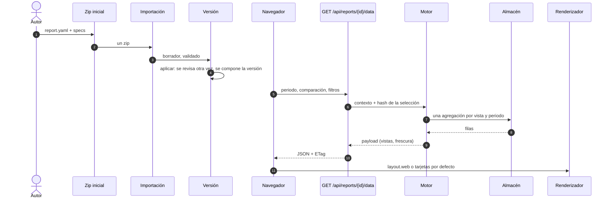

🇪🇸 Español · 🇬🇧 [English](../RENDERING.md)

# Cómo un reporte se convierte en tablero

[AUTHORING.md](./AUTHORING.md) cuenta cómo se escribe una carpeta; [REPORTS.md](./REPORTS.md)
enumera todos los campos. Esta página es la tercera parte: **qué hace Bizview con el `report.yaml`
que escribiste**, desde que aplicas el proyecto hasta que alguien pasa el puntero por una barra. Cada
afirmación de abajo nombra el archivo que la cumple, para que puedas comprobarla en el código.

La versión corta: tu YAML nunca se convierte en código. Se convierte en una **versión** (un árbol
validado), el motor traduce cada entrada de `views` en **una consulta SQL por periodo**, y el
navegador dibuja el payload con el **layout** que declaraste — o con una tarjeta por vista cuando no
declaraste ninguno.

## El camino en una imagen



Fuente: [docs/assets/rendering.mmd](../assets/rendering.mmd), dibujado como
[rendering.svg](../assets/rendering.svg).

## 1. Aplicar — el YAML entra en una versión

La importación guarda el zip como proyecto **borrador**; aplicar es lo que lo pone en producción. Al
aplicar se valida el árbol otra vez — con el mismo validador que usa la CLI,
`cli/bizview_cli/validate.py` — y solo entonces se compone el proyecto con los demás en una nueva
**versión del espacio de trabajo**: `apply` y `_apply_composed` en
[workspace/service.py](../../backend/app/workspace/service.py). Una versión activa es inmutable, y
por eso todo lo que viene después puede cachear contra su id.

Dos cosas pasan en ese momento y en ningún otro:

- cada reporte se vuelve una **fila de tablero** — id, título, descripción, icono, orden,
  `available` — en `sync_dashboards` ([workspace/service.py](../../backend/app/workspace/service.py));
  un reporte que salió de la versión queda *oculto*, nunca borrado;
- `access.roles` empieza a decidir quién puede abrirlo. Se lee en cada petición, no se guarda:
  `_context` en [api/reports.py](../../backend/app/api/reports.py) rechaza un reporte cuyos roles
  dejan fuera al que pregunta, y `access.grants: true` exige además el permiso por usuario.

Volver atrás (`rollback`, mismo archivo) archiva la versión actual y activa la anterior: los mismos
tableros, los mismos permisos, las definiciones viejas.

## 2. Contexto — los alias se vuelven tablas y columnas

El motor nunca lee tus nombres de `uses` al consultar. `_build_context`
([engine/report.py](../../backend/app/engine/report.py)) resuelve cada alias a
`ds_<integración>.<conjunto>` — `schema_name` en
[engine/datasets.py](../../backend/app/engine/datasets.py) arma el esquema a partir del id de la
integración — y toma los **contratos de columna** de la definición de la integración, así que
`lines.net_amount` se sabe que existe, y se sabe que es numérico, antes de construir ningún SQL.

Ese contexto se memoriza por versión (`cached_context`, mismo archivo): una versión no cambia, así
que la definición parseada y los contratos se construyen una sola vez por proceso. Todavía no corrió
nada.

## 3. Petición — periodo, comparación, filtros

La pantalla llama a `GET /api/reports/{id}/data` con los parámetros que están en la URL:

```text
period=mtd&compare=previous_period&filter.product=A-1&filter.product=B-2
```

`selection` ([engine/report.py](../../backend/app/engine/report.py)) acepta solo lo que el reporte
permite — `periods.allowed`, `compare.allowed` — y `periods.resolve`
([engine/periods.py](../../backend/app/engine/periods.py)) convierte el preset en dos **fechas
locales inclusivas** más el rango de comparación. "Local" es la zona horaria de la instalación:
`_today` en [api/reports.py](../../backend/app/api/reports.py) pregunta a la configuración, no al
navegador, así que la pantalla y el PDF siempre coinciden en qué es "hoy".

Dos valores forman la clave de caché, y los dos se calculan en un solo viaje
(`data_version_and_cached`, [engine/report.py](../../backend/app/engine/report.py)):

- el **hash de la selección** — SHA-256 de los rangos resueltos y los filtros, `selection_hash`;
- la **versión de datos** — `v<id de versión>-r<id de la última corrida exitosa>`, `data_version`.

El payload se guarda en `report_cache` y se responde con `ETag: "<data_version>-<hash>"`
(`_data` y `report_data` en [api/reports.py](../../backend/app/api/reports.py)); una petición que
repite el ETag recibe `304` y no dibuja ninguna consulta. Una carga nueva de la integración cambia
el id de la corrida, así que cambia la clave y la siguiente petición recalcula — esa es toda la
historia de frescura del §6.

## 4. Las vistas se vuelven SQL

Cada entrada de `views` es una agregación por periodo, construida por `aggregate`
([engine/report.py](../../backend/app/engine/report.py)):

- **FROM** — el alias base de `date`, más los joins en el orden en que conectan (`from_clause`); un
  join que no alcanza el alias base es una tarjeta de error, no un producto cartesiano silencioso;
- **WHERE** — `date BETWEEN :start AND :end` y un `expr::text IN (...)` por filtro (`_where`);
- **SELECT** — el fragmento `sql` de cada métrica, revisado contra la lista blanca y regenerado con
  identificadores entre comillas por `expression`, así que lo que corre es la expresión parseada, no
  tu cadena;
- **GROUP BY / ORDER BY / LIMIT** — por posición y por alias de métrica, nunca por texto
  interpolado.

Esta es una sentencia real que el motor produjo para una vista `ranking` (productos por ventas
netas, top 5), capturada del motor, no escrita a mano:

```sql
SELECT "products"."product_code" AS "g0",
       SUM(CASE WHEN "lines"."line_kind" = 'sale' THEN "lines"."net_amount"
                ELSE -"lines"."net_amount" END) AS "m_net_sales"
FROM "ds_ventas_prueba"."sale_lines" AS "lines"
LEFT JOIN "ds_ventas_prueba"."products" AS "products"
       ON "lines"."product_code" = "products"."product_code"
WHERE ("lines"."local_date")::date BETWEEN '2026-09-01'::date AND '2026-09-30'::date
GROUP BY 1
ORDER BY "m_net_sales" DESC NULLS LAST, 1
LIMIT 5
```

Las fórmulas no son SQL: `aggregate` devuelve las métricas SQL y `evaluate` aplica la fórmula sobre
ellas, así que `avg_ticket: net_sales / orders` es una división de dos agregados, y una base cero da
nulo en vez de un error.

Qué pide cada tipo de vista:

| Vista | Consultas por periodo | Resultado |
|---|---|---|
| `kpis` | una agregación, sin agrupar | una fila de métricas |
| `ranking` | una agregación agrupada por la dimensión, ordenada por la métrica y limitada; más el total para el `share`; más una consulta acotada a las claves anteriores | el top N con `share`, `previous` y `change` |
| `trend` | una agregación agrupada por `date_trunc(grain, date)` | un punto por cubo, incluidos los huecos |
| `table` | una agregación agrupada por las dimensiones declaradas, ordenada por la primera métrica | filas y sus columnas |

La comparación es una segunda corrida sobre el rango anterior, emparejada por clave: `ranking` pide
exactamente las claves que devolvió, `trend` empareja cubo por cubo, `kpis` compara la única fila.
`change` ([engine/periods.py](../../backend/app/engine/periods.py)) convierte el par en un porcentaje
y marca la base cero como *nuevo* en vez de inventar un 100 %.

Un reporte con `materialize: daily` no lee el conjunto cuando su resumen está fresco: `routed`
([engine/report.py](../../backend/app/engine/report.py)) cambia el FROM por la tabla del resumen —
`mv_<id del reporte>` (los guiones se vuelven guiones bajos), una fila por día y dimensión, mantenida por
[engine/rollup.py](../../backend/app/engine/rollup.py) — y `_raw_on_missing` vuelve al camino crudo
(marcando el resumen como viejo) si desapareció la tabla o una columna.

El aislamiento, porque el mismo código corre para cada cliente: las sentencias corren en una
transacción de solo lectura con límite de 15 s, los valores viajan como literales de psycopg, las
vistas del reporte se calculan de cuatro en cuatro (`PARALLEL_VIEWS`), y **una vista que falla es
solo esa tarjeta** (`_run_view`, `_failed_view`); una vista sin nada lo dice (`_mark_empty`) en vez
de verse rota.

## 5. Dibujar — layout, tarjetas, formatos

El navegador pide la definición (`GET /api/reports/{id}`) y los datos, y después
[ReportViews.tsx](../../frontend/src/components/report/ReportViews.tsx) decide:

- **hay layout declarado** (`layout.web`):
  [LayoutRenderer.tsx](../../frontend/src/components/report/LayoutRenderer.tsx) dibuja la rejilla de
  12 columnas y cada componente se ata a una vista **por id** (`resolveView`), con `metric`,
  `x`/`series`, `category`/`value` eligiendo qué lee de ella. El span, la altura mínima y los tokens
  del tema son el contrato del layout (026); los avisos de validación viajan en `layout_problems`
  (`engine/report.py`) y se muestran como una nota discreta, nunca como un fallo;
- **sin layout**: una tarjeta por defecto por vista, en el orden del payload, cada tipo con la suya.

Los números se formatean **en el navegador**: `format:` (`number`, `integer`, `currency`, `percent`)
y la moneda de la instalación pasan por
[numbers.ts](../../frontend/src/lib/numbers.ts), así que un valor se lee `84.401,05 USD` en español y
`84,401.05 USD` en inglés. El PDF usa las mismas reglas del lado del servidor (`fmt` en
[reports/pdf.py](../../backend/app/reports/pdf.py)) sobre el *mismo* payload, y los bloques
`layout.pdf` cuando el reporte los declara — por eso el papel y la pantalla no pueden contradecirse.

La URL guarda el estado: `period`, `compare`, `from`/`to`, `filter.<dimensión>` y, en una tarjeta
ampliada, `ampliar=<id del componente>` ([reportQuery.ts](../../frontend/src/lib/reportQuery.ts)). El
modo TV ignora `ampliar`, así que un enlace compartido no puede dejar un televisor atrapado en un
diálogo.


## Cross-filter (feature 063)

Un clic en una marca se convierte en un parámetro normal `filter.<dimension>=<valor>`; el motor lo ve
en `selection` y todas las vistas se agregan con él. Para la vista dueña de la dimensión activa el
payload lleva además `source_views[dimension][view id]`, calculada con todos los filtros **menos** esa
dimensión, para que el gráfico conserve todas sus marcas y resalte la elegida. Un componente con
`cross_filter: ignore` lee `ignore_views[view id]`. Una dimensión puede declarar `key: <sql>`; el
filtro lo usa y la vista sigue mostrando `sql`.

## Ver como tabla (feature 064)

La tabla de una tarjeta se construye en el navegador con la vista que el payload ya trae; abrirla no
hace ninguna petición. `?tabla=<id del componente>` la nombra, sola o junto a `ampliar`. **Ver todas
las filas** pide la misma selección con `full=1`, que eleva el `limit` de ranking/tabla a 1.000 y
marca `truncated` en las vistas, bajo una clave de caché propia (`<hash de selección>:full`). El
modelo vive en [dataTable.ts](../../frontend/src/lib/dataTable.ts); el diálogo reutiliza `CardDialog`
y su trampa de foco.

## 6. Frescura — cuándo cambian los números

| Lo que ves | Qué pasó |
|---|---|
| "Datos actualizados …" | el `freshness.updated_at` del payload: la última carga exitosa de las integraciones que lee |
| la página se refrescó sola | el auto-refresco consultó `GET /api/reports/{id}/version` y encontró otra `data_version` ([autoRefresh.ts](../../frontend/src/lib/autoRefresh.ts)) |
| cifras de ayer, con etiqueta | `materialize: daily` leyó la foto guardada de ese día ([engine/snapshot.py](../../backend/app/engine/snapshot.py)) |
| un aviso de datos viejos | un reporte directo no pudo llegar a su fuente; se muestran las últimas cifras con su hora ([freshness.ts](../../frontend/src/lib/freshness.ts)) |

Un reporte de conjuntos está **tan fresco como su última carga**: el worker escribe en
`ds_<integración>.<conjunto>`, la corrida queda registrada, y la siguiente petición ve un id de
corrida nuevo y recalcula. Nada más caduca.

## Qué controla cada clave en tiempo de ejecución

| Clave | Qué decide | Quién la lee |
|---|---|---|
| `date` | la columna sobre la que filtra el rango, y el alias base de los joins | `date_expression`, `from_clause` |
| `periods` | qué presets se aceptan y con cuál abre el reporte | `selection`, `ReportDefinition` |
| `compare` | si corre un segundo rango, y cuál | `selection`, `periods.previous_range` |
| `filters` | qué parámetros `filter.<dimensión>` se leen, y la lista del `IN` | `selection`, `_where` |
| `metrics.sql` | el fragmento SQL que se agrega | `expression`, `aggregate` |
| `metrics.formula` | un valor calculado después de los agregados | `evaluate` |
| `views.limit` | cuántas filas devuelve un ranking o una tabla | `view_ranking`, `view_table` |
| `layout.web.span` | cuántas de las doce columnas toma la tarjeta | `LayoutRenderer` |
| `materialize` | si se lee el resumen en vez del conjunto | `routed`, `rollup` |
| `access` | quién puede abrir el tablero, y si hace falta además un permiso | `_context` |

## Dónde mirar cuando no dibuja

- **Una tarjeta dice "sin datos"** — el rango está vacío para esa vista; el mensaje nombra los
  conjuntos vacíos cuando lo está el conjunto entero (`_empty_refs`).
- **Una tarjeta muestra un error con una referencia** — esa vista falló y las demás no; la
  referencia ata la tarjeta con sus líneas en el registro del servidor (`render_reference`).
- **El tablero se ve distinto del YAML** — la validación rebajó parte del layout; las notas sobre la
  rejilla dicen qué componente y por qué (`layout_problems`).
- **Los números están viejos** — mira la última corrida de la integración: su id es parte de
  `data_version`.

## Relacionados

- [AUTHORING.md](./AUTHORING.md) — la carpeta, la petición, las nueve comprobaciones.
- [REPORTS.md](./REPORTS.md) — todos los campos de una integración y de un reporte.
- [IMPORT.md](./IMPORT.md) — qué hacen la importación y el aplicar, paso a paso.
- En la app: **Ayuda → Crear con tu IA → Cómo se dibuja un tablero**
  ([Abrir Ayuda → Crear con tu IA](app:/ayuda)).
